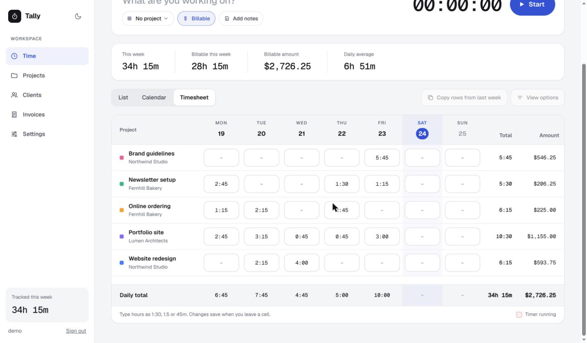
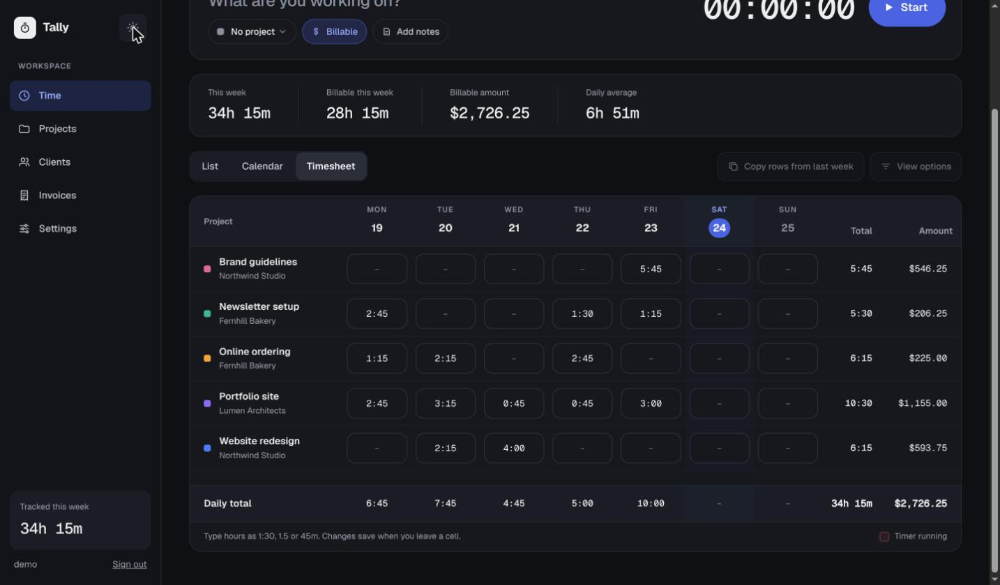

# Tally

A personal time tracker and invoicing app for a freelancer: track time with a timer, see it as a list, a calendar or a timesheet, organise it by client and project, and turn it into invoices with Québec taxes (GST 5 %, QST 9.975 %).

It is built on Drupal, but used as an **application framework**, not a CMS. There are no nodes, no toolbar and no admin theme in sight: every screen is a custom route in a custom module, rendered by a custom theme. Live behaviour (the ticking timer, autosaving forms, dialogs) uses [HTMX](https://htmx.org), through the version that ships with Drupal core, with very little JavaScript of our own.

## Screenshots

The Timesheet view, in light and dark mode (demo data):





## Screens

| Screen | What it does |
| --- | --- |
| Time | A timer card, week totals, and four views: **List** (entries by day, with search and filters), **Calendar** (Day and Week), **Timesheet** (hours per project per day, editable). Click an entry to edit it. |
| Projects | Projects with their rate source (own rate, client rate, or not billable), an edit dialog, banks of hours, and a report with a chart. |
| Clients | Clients with a default rate and currency, their projects, and a report by project. |
| Invoices | Invoices by status, an autosaving editor with fixed-price, bank-of-hours and hosting items, and GST/QST. |
| Settings | Account (name, email, password), accent color, business details (company name, address, GST and QST numbers), invoicing defaults (currency, GST and QST rates, payment terms) and time defaults. Saved per user in `user.data`. |
| Sign in | Email or username and password. There is no registration: the administrator creates accounts. |

The interface is in French by default and every string is translatable. Each user picks French or English in Settings (Appearance, Interface language); the choice is stored on the account (`preferred_langcode`), and the sign-in screen follows the site default (French). The French wording, including month and day names and the order of the parts of a date, is in `web/modules/custom/tally/translations/fr.po`.

## Stack

- Drupal 11 on the `minimal` profile, with only core modules plus ours. Gin is installed as the admin theme for the rare visit to `/admin`.
- `web/modules/custom/tally`: custom content entities (client, project, time entry, invoice, invoice item), routes, controllers and services.
- `web/themes/custom/tally_theme`: the Twig templates and CSS for every screen, including sign-in. Light and dark mode follow the system, with a toggle.
- Local development with [DDEV](https://ddev.com).

## Getting started

You need [DDEV](https://ddev.com/get-started/) (1.25 or newer); the [installation guide](https://docs.ddev.com/en/stable/users/install/) covers Linux, macOS and Windows, and the [DDEV documentation](https://docs.ddev.com/en/stable/) explains day-to-day use (`ddev start`, `ddev stop`, `ddev launch`). From a fresh clone:

```shell
ddev start                      # also runs composer install
```

`web/sites/default/settings.php` is created by DDEV and is not in git, so one setting has to be added by hand: where the configuration lives. Add this line to it, then install the site from the exported configuration and open the link the last command prints:

```shell
echo "\$settings['config_sync_directory'] = '../config/sync';" >> web/sites/default/settings.php
ddev drush site:install --existing-config --yes --account-name=you --account-mail=you@example.com
ddev drush user:login /time     # a one-time sign-in link that lands on the Time screen
```

Every account has the `use tally` permission through the authenticated role. To add a person:

```shell
ddev drush user:create jane --mail=jane@example.com --password='a long password'
```

Each person only ever sees their own clients, projects, entries and invoices.

## Everyday commands

```shell
ddev drush cr                   # rebuild caches (after changing templates or services)
ddev drush updatedb --yes       # run update hooks, for example after a schema change
ddev drush config:export --yes  # write configuration changes to config/sync
ddev drush config:import --yes  # apply config/sync to the site
```

Configuration lives in `config/sync` and is committed. Anything the app creates as data (clients, entries, invoices) lives in the database, not in config.

## How it is put together

- **Money is integer cents**, never floats. Tax is integer-only: `intdiv($subtotal * $rate + 50000, 100000)` with the rates held as percentage times 1000 (GST 5000, QST 9975), rounded half up. See `Entity/Invoice.php`.
- **The URL is the state** on Projects, Clients, Invoices and Time. What is open (a dialog, a filter, a week) is in the query string, so reload, back and shared links work, and each HTMX request is "fetch this URL and keep this element".
- **Screens are built in PHP, templates stay dumb.** A builder service (`TimeScreenBuilder`, `ProjectScreenBuilder`, `ClientScreenBuilder`, `InvoiceScreenBuilder`) computes everything a template needs. `ListScreenBuilder` holds what Projects and Clients share.
- **Time zone** comes from the user, so days and weeks are the user's, and weeks start on Monday.
- **Banks of hours** are not stored. They are worked out from "bank of hours" invoice items: hours on paid invoices are paid, on sent ones awaiting payment, on drafts in draft. Hours used are the time tracked on the project.
- **Access.** Every Tally entity belongs to a user, and `TallyAccessControlHandler` allows its owner (and administrators). Anonymous visitors are redirected to sign-in.

The Twig templates in `web/modules/custom/tally/templates` carry short notes on the HTMX patterns each screen uses (autosave with out-of-band updates, live previews, `HX-Push-Url`, request queuing), if you want to learn from them.

## Design

The designs are in `design/` as `.dc.html` files, one per screen. They are design-tool source, not runnable pages: they use a small templating runtime that is not included. Read them for layout, copy and behaviour. The design tokens are CSS custom properties in the theme.

## Sharing and PDF

A sent invoice has a **Share** button that copies its public link, `/i/{token}`, to the clipboard. The token is 43 random characters made when the invoice is sent, so links cannot be guessed. Anyone with the link sees a read-only copy of the invoice and can download it as a PDF; a draft, or an unknown token, is a plain 404. The same document template draws the page and the PDF (dompdf), using the business details from the invoice owner's Settings: company name, an optional text under it, the logo (PNG or JPG, up to 1 MB, shown left of the name), address, and the GST and QST numbers. The logo is embedded in the page and the PDF. Each invoice has a **language**, English or French. A client has a default (set on the client, and Settings gives the default for new clients); a new invoice starts with its client's language, and you can change it on the draft. It decides the wording, dates and money format of the shared page and the PDF (for example "Facturé à", "TPS", "1 140,00 $") and the language of Stripe's payment page. The wording is translated with Drupal's `language` and `locale` modules: the French is in `web/modules/custom/tally/translations/fr.po`, imported with `ddev drush locale:update` (translations are kept local, nothing is downloaded, and there is no `/fr/...` path prefix: the interface language comes from the user's account, then the site default). Dates and money use PHP's intl. The signed-in **PDF** button downloads the same file for attaching to an email by hand.

## Payments (Stripe)

The public invoice page offers **Pay with credit card** on a sent invoice: it starts a hosted Stripe Checkout for the invoice total (one line, in cents). The invoice only becomes Paid when Stripe's webhook says so: `/stripe/webhook` checks the signature, then the amount and currency, then runs the same "Mark as paid" as the app (payment date in the owner's timezone). Back from Stripe, the page says "Confirming your payment" and checks every 2 seconds with HTMX, for up to 30 seconds. A payment that does not match the invoice, or arrives for a draft or cancelled invoice, changes nothing and is logged (Reports > Recent log messages, type `tally`); the money is then in the Stripe dashboard. Partial payments are not supported.

Each user connects their own Stripe account in **Settings > Payments (Stripe)**: the secret key (a restricted `rk_...` key that can only write Checkout Sessions is safest) and the webhook signing secret. Both are stored encrypted with libsodium, keyed from `$settings['tally_encryption_key']` in `settings.php` when set, otherwise from the site's hash salt; changing either makes saved keys unreadable and they must be entered again. Settings also shows the user's own webhook URL, `/stripe/webhook/{random id}`: add it as a webhook endpoint in Stripe, and its `whsec_...` goes in the field below. A payment can only mark invoices of the user whose URL and secret it came in on. Without a secret key there is no pay button; without the webhook secret the webhook answers 503.

To try it locally, use Stripe's test mode and the Stripe CLI: `stripe listen --forward-to <the webhook URL from Settings>` prints the `whsec_...` to save, then pay with card 4242 4242 4242 4242. The webhook listens for `checkout.session.completed` and `checkout.session.async_payment_succeeded`, as full events or as the newer "thin" events (which only point at the session, so Tally fetches it from Stripe).

## Deployment

The repo ships a `Dockerfile` (PHP 8.4 + Apache) and the files a [Dokku](https://dokku.com) deployment needs, and nothing in it ties you to one host. The same image runs on any Docker platform.

- `deploy/settings.php` becomes the container's `settings.php`. It reads `DATABASE_URL`, `HASH_SALT`, `TALLY_ENCRYPTION_KEY` and `TRUSTED_HOSTS` from the environment, so no secret is in git. **Back up `HASH_SALT` and `TALLY_ENCRYPTION_KEY`**: users' saved Stripe keys are encrypted with them, and if either is lost or changed the keys must be entered again.
- `postdeploy.sh` runs after each deploy: on an empty database it installs the site from `config/sync` (the first admin comes from `INITIAL_ADMIN_NAME`, `INITIAL_ADMIN_MAIL` and `INITIAL_ADMIN_PASS`, set only for that first deploy and then removed), then runs `updatedb`, `config:import` and `locale:update`.
- Persistent storage: mount one volume on `web/sites/default/files` (logos) and one on `/private`. `app.json` schedules `drush cron` every 15 minutes.
- `.gitlab-ci.yml` deploys a push to `main` over SSH. It needs `HOST`, `PROJECT_NAME` and `SSH_PRIVATE_KEY` as CI variables.
- Back up the database and the logos volume, and keep the two secrets above somewhere safe.
- Each user then saves their own Stripe keys in Settings, and adds the webhook URL shown there in their Stripe dashboard.

## Tests

PHPUnit comes from `drupal/core-dev` (dev only). Run the module tests with:

```
ddev exec vendor/bin/phpunit -c phpunit.xml.dist --testsuite tally
```

Kernel tests use an in-memory SQLite database.

## Not built yet

- "Keep me signed in" on the sign-in screen.
- The holiday label on the Week and Timesheet views (there is no holiday data yet).
- "View options" on the Time screen.
- A week start day setting (weeks always start on Monday).
- Employees and levels of access. Today one user is one business: each person only sees their own clients, projects, entries and invoices, so a company cannot share one workspace between several people or give them different permissions.
- Invoice templates and themes. Every invoice uses one fixed layout, on the shared page and in the PDF: the business name, the logo if there is one, the invoice details, and the tax numbers at the bottom. There is no way yet to choose a template or change its look.
- Linking time entries to invoices, so that hours could be shown as billed or unbilled.

## Contributing and licence

See [CONTRIBUTING.md](CONTRIBUTING.md). Tally is released under the GPL-2.0-or-later, like Drupal itself (see `LICENSE.txt`).
